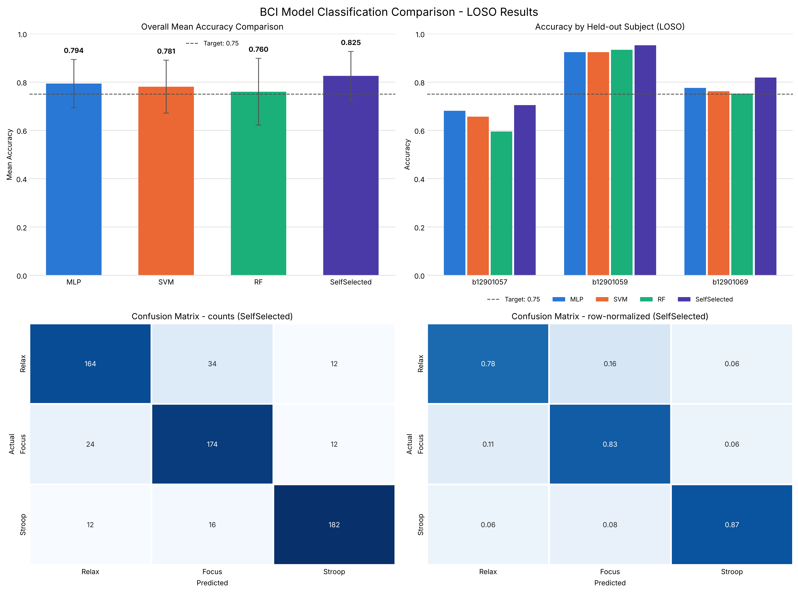

# 實驗三：腦機介面應用（第 5 組）

用 BrainLink 單通道（Fp1，512 Hz）乾電極 EEG，分類 Relax、Focus、Stroop 三種狀態，並以三位組員的 Leave-One-Subject-Out (LOSO) 交叉驗證比較四個分類器。

## 結果

| 模型 | LOSO 平均準確率 ± 標準差 |
| --- | --- |
| Shrinkage LDA（自選模型） | **0.825 ± 0.101** |
| SVM | 0.811 ± 0.097 |
| MLP | 0.795 ± 0.099 |
| Random Forest | 0.751 ± 0.121 |

標準差是三個 fold 之間的差異。每位受試者的準確率、混淆矩陣見 `results_summary.txt` 和報告第 3 節。

## 檔案結構

```
.
├── main.py                        # 繳交的程式，只修改了指定的 STUDENT 區塊和 Config
├── main_original.py               # 助教提供的原始框架，報告用它對照初始超參數
├── bci_dataset_115-1/             # 三位組員各 30 個檔案，共 90 個（學號_類別_輪次.txt）
├── check_data.py                  # 檢查檔名和每個檔案的長度（10240 點）
├── results_summary.txt            # main.py 的文字輸出
├── bci_multi_model_comparison.png # main.py 的結果圖
├── ablation.py                    # 報告 Table 4 和 Table 7 的 ablation study
├── ablation_results.txt           # ablation.py 的輸出
├── exp_testing/                   # 超參數和 pipeline 實驗：exp_*.py 及其輸出 results_*.txt
├── report/                        # 報告的 LaTeX 原始檔（XeLaTeX）
├── pyproject.toml, uv.lock        # uv 環境
└── README.md
```

## 執行方式

```bash
uv sync                                # 建立環境（Python 3.11）
uv run python check_data.py            # 檢查資料
uv run python main.py                  # LOSO，輸出 results_summary.txt 和 bci_multi_model_comparison.png
uv run python ablation.py              # 輸出 ablation_results.txt
uv run python exp_testing/exp_svm.py   # 另有 exp_mlp / exp_rf / exp_lda / exp_pipeline
```

所有腳本都要從專案根目錄執行。`ablation.py` 和 `exp_testing/` 只 import `main.py` 的函式，不會修改或執行它。

## 最終的 main.py

細節見程式註解和報告第 2 節。

* 前處理（Part 1）：去 DC、60 Hz notch、1~45 Hz 帶通，8 秒切段、重疊 75%，每個 20 秒錄音 7 段。
* 特徵（Part 2）：段內每 1 秒算一次相對 theta / alpha / low beta / high beta、log(θ/β)、log(α/β)、log 標準差和 kurtosis，再取整段的平均、標準差、90 百分位和最大值，共 32 個。接著每位受試者用自己全部片段的平均和標準差做 z-score（不使用 label）。
* 模型：自選模型是 shrinkage LDA。MLP (256, 128, 64)、learning rate 0.0005、alpha 0.05；SVM rbf、C = 0.01；RF 500 棵樹、max_depth 5。超參數由 `exp_testing/` 裡的實驗決定。
* 後處理：沒有使用，每個 8 秒片段各自判斷。

## 報告

`report/` 是報告的 LaTeX 原始檔，用 XeLaTeX 編譯：

```bash
cd report && latexmk -xelatex main.tex
```

也可以把 `report/` 整個上傳到 Overleaf（編譯器選 XeLaTeX）。編譯產生的 PDF 和暫存檔不放進 git。

## 課程原始說明

以下是助教提供的原始 README，保留作為參考。其中描述的初始狀態（例如 `extract_features()` 直接回傳原始訊號、四個模型使用預設超參數）指的是 `main_original.py`，不是目前的 `main.py`。

### 1. 專案概述

本專案提供一個基於 Python 的機器學習框架，用於分析 EEG 訊號，並將其分類為 **放鬆 (Relax)、專注 (Focus) 與認知衝突 (Stroop)** 三種狀態。

本學期使用 **BrainLink 腦波儀 (單通道 Fp1, 取樣率 512 Hz)**。每組需使用自行錄製的腦波資料來訓練模型。本次實驗不限制僅使用單一模型，而是需要實作並比較多種分類器的效能。

任務：
- **模型比較**：必須在專案中同時評估與比較**至少 4 種分類模型**：
  1. **MLP**
  2. **SVM**
  3. **RF**
  4. **自選** (需自行引入並建構)
- **特徵工程與優化**：在指定區塊內設計並實作合適的**資料前處理與特徵提取**。
- **評估方式**：透過 **Leave-One-Subject-Out (LOSO)** 的驗證方式評估各模型效能。
- **實驗目標**：最佳模型的 Overall Mean Accuracy 達 75% 以上。

> ⚠️ **不提供已調校好的 baseline 模型**。`main.py` 中的 `extract_features()` 目前直接回傳原始時域訊號，四個模型的超參數也僅為預設值，請勿將其視為參考成績。

### 2. 環境設定 (使用 `uv`)

本專案範例使用 Python 套件管理器 **`uv`** 來建立虛擬環境與安裝套件。

1. **安裝 `uv`** (若尚未安裝)：
   - Windows (PowerShell): `irm https://astral.sh/uv/install.ps1 | iex`
   - macOS/Linux: `curl -LsSf https://astral.sh/uv/install.sh | sh` or `brew install uv`
2. **建立虛擬環境**：
   開啟終端機並切換到專案資料夾，輸入：
   ```bash
   uv venv
   uv sync
   ```
   即可複製同環境並執行 `main.py`。

也可以使用其他方法建置環境，確保檔案能執行即可。

### 3. 檔案結構

請確保專案資料夾結構如下，程式與資料需放在同一目錄下。
EEG 資料命名格式說明：`組員學號_類別_輪次.txt`。

```bash
your_project_folder/
├── main.py                # （提供）主要 Python 程式
├── pyproject.toml         # （提供）供 uv 複製環境
├── uv.lock                # （提供）供 uv 複製環境
└── bci_dataset_115-1/     # 新增你這組受試者資料的資料夾
    ├── 學號1(小寫)/
    │   ├── 學號1_1_1.txt   # 放鬆狀態 (Relax) 第 1 輪
    │   ├── ... (共10輪)
    │   ├── 學號1_2_1.txt   # 專注狀態 (Focus) 第 1 輪
    │   ├── ... (共10輪)
    │   ├── 學號1_3_1.txt   # 認知衝突 (Stroop) 第 1 輪
    │   └── ... (共10輪，合計30個檔案)
    ├── 學號2(小寫)/
    │   └── ... (共30個檔案)
    └── 學號3(小寫)/
        └── ... (共30個檔案)
```

- 每個 `.txt` 檔為單欄 EEG 時域數值訊號，代表一個 **20 秒** 的 block。
- 取樣率：512 Hz (BrainLink 預設，每檔案應有約 10240 筆數據)。
- `_1_` 代表 放鬆狀態 (Relax)，標籤為 0。
- `_2_` 代表 專注狀態 (Focus)，標籤為 1。
- `_3_` 代表 認知衝突 (Stroop)，標籤為 2。
- 每位受試者 10 輪 × 3 類 = 30 個檔案；三人一組共 90 個檔案。

### 4. 參數與超參數調整

各組可自由調整 `main.py` 中的 Config 類別，針對四種模型調整對應的超參數以達到最佳效能：

| 模型 | 可調整超參數範例 |
| --- | --- |
| MLP | `HIDDEN_LAYERS`, `LEARNING_RATE`, `ALPHA` (L2), `MAX_ITER` |
| SVM | 核函數類型 (`SVM_KERNEL`)、懲罰參數 (`SVM_C`) |
| RF | 決策樹數量 (`RF_ESTIMATORS`)、最大深度 (`RF_MAX_DEPTH`) |
| 自選模型 | 依所選模型之參數而定 |
| 資料切片 | `SEGMENT_LENGTH`, `OVERLAP_RATIO` |
| 特徵選擇 | `FEATURE_SELECTION`, `N_FEATURES_SELECT` |

### 5. 程式修改提示

請在程式碼中尋找以下標註的區塊進行修改與實作：
1. 前處理與特徵工程：
     - `# === STUDENT PREPROCESSING HERE (Part 1)===` (時域訊號前處理)
     - `# === STUDENT PREPROCESSING HERE (Part 2)===` (特徵工程)
2. 自選模型實作：
     - `# === STUDENT MODEL IMPORT HERE ===` (引入第四種自選分類模型)
     - `# === STUDENT MODEL HERE ===` (建構並設定該模型)
3. 後處理（選填）：
     - `# === STUDENT POSTPROCESSING HERE ===` 

> `main.py` 在 `main()` 中只載入一次資料集，四個模型共用同一組特徵，請勿針對個別模型套用不同的前處理，否則比較不具意義。

### 6. 輸出結果解讀

程式執行後會產生兩個檔案：

- `results_summary.txt`：文字版摘要，可直接貼進報告。
- `bci_multi_model_comparison.png`：結果圖。

#### a. 終端機輸出範例

以下數值僅為格式示意，不代表可達成的成績。

```bash
...
==================================================
Summary of Classification Results (LOSO):
 - MLP         : 0.XXX +/- 0.XXX
 - SVM         : 0.XXX +/- 0.XXX
 - RF          : 0.XXX +/- 0.XXX
 - SelfSelected: 0.XXX +/- 0.XXX

Best Performing Model: XXX with Accuracy 0.XXX
  -> reached the 75% target

Accuracy per held-out subject:
Subject        MLP           SVM            RF  SelfSelected
學號1         0.XXX         0.XXX         0.XXX         0.XXX
學號2         0.XXX         0.XXX         0.XXX         0.XXX
學號3         0.XXX         0.XXX         0.XXX         0.XXX

Detailed Class Report for Best Model [XXX]:
[Relax Class]
  - Accuracy (Recall): 0.XXX (XXXX/XXXX)
  - Precision: 0.XXX (XXXX/XXXX)
  - F1-score: 0.XXX

[Focus Class]
  - Accuracy (Recall): 0.XXX (XXXX/XXXX)
  - Precision: 0.XXX (XXXX/XXXX)
  - F1-score: 0.XXX

[Stroop Class]
  - Accuracy (Recall): 0.XXX (XXXX/XXXX)
  - Precision: 0.XXX (XXXX/XXXX)
  - F1-score: 0.XXX

Overall Confusion Matrix [XXX] (rows = true, cols = predicted):
               Relax     Focus    Stroop
Relax           XXXX      XXXX      XXXX
Focus           XXXX      XXXX      XXXX
Stroop          XXXX      XXXX      XXXX

Results saved in 'bci_multi_model_comparison.png' and 'results_summary.txt'
```

指標定義（皆由混淆矩陣計算，列為真實標籤、行為預測標籤）：

- `Recall = TP / (TP + FN)`：該類別實際樣本中被正確分類的比例，對應混淆矩陣的**列**。
- `Precision = TP / (TP + FP)`：被預測為該類別的樣本中真正屬於該類的比例，對應混淆矩陣的**行**。
- `F1 = 2 · Precision · Recall / (Precision + Recall)`。

#### b. 圖片輸出



圖中共四個子圖：

1. 四種模型的平均準確率長條圖，誤差棒為 LOSO 三折的標準差，並標示 0.75 門檻線。
2. 每位受試者（作為 test set 時）在四種模型下的準確率，用於觀察個體差異。
3. 最佳模型的整體混淆矩陣（次數）。
4. 最佳模型的整體混淆矩陣（依列正規化，即各類別的 recall）。

### 7. 評分標準

- **規範遵守 (20%)**：成功實作並評估至少四種模型，且無違反框架結構。
- **準確度表現 (40%)**：最佳模型的跨受試者平均準確率達 ≥75% 得 35%，達 ≥80% 得 40%。
- **報告撰寫與分析 (40%)**：詳細說明前處理、特徵工程方法，並深入比較與討論四種模型之表現。

### 8. 繳交報告

```bash
115_1_gX_exp3.zip/
├── 115_1_gX_exp3.pdf       # 報告
├── main.py                 # 修改完的程式
└── bci_dataset_115-1/      # 放你這組當受試者資料的資料夾
    ├── 學號1(小寫)/
    │   ├── 學號1_1_1.txt   # 放鬆狀態 (Relax) 第 1 輪
    │   ├── ... (共10輪)
    │   ├── 學號1_2_1.txt   # 專注狀態 (Focus) 第 1 輪
    │   ├── ... (共10輪)
    │   ├── 學號1_3_1.txt   # 認知衝突 (Stroop) 第 1 輪
    │   └── ... (共10輪，合計30個檔案)
    ├── 學號2(小寫)/
    │   └── ... (共30個檔案)
    └── 學號3(小寫)/
        └── ... (共30個檔案)
```
